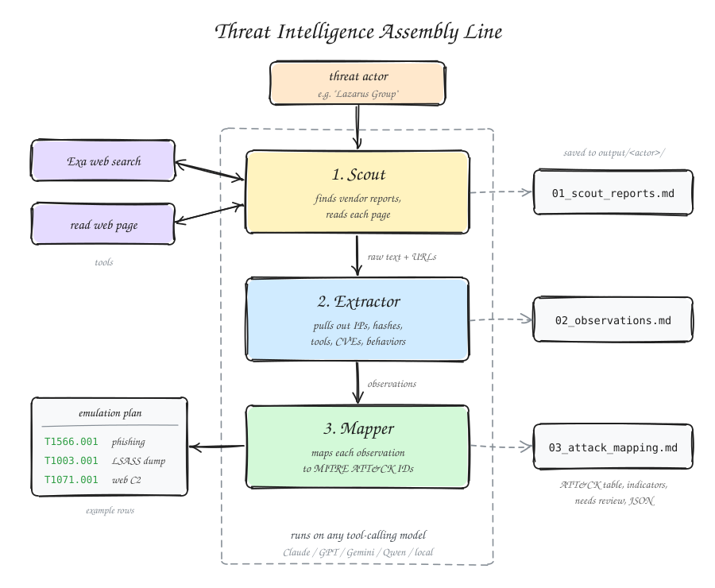

# Threat Intelligence Assembly Line (Python, model-agnostic)
 
Give it a threat actor name and it finds vendor reports, extracts the technical observations, and maps them to MITRE ATT&CK for adversary emulation planning.
 
This project requires two API keys: one from [exa.ai](https://exa.ai) for web search, and one from an LLM vendor of your choice (e.g. Gemini, Claude, ChatGPT, Qwen).
 

 
1. **Scout**: searches Exa for vendor reports on the actor and scrapes each page.
2. **Extractor**: pulls every technical observation out of the report text.
3. **Mapper**: maps observations to MITRE ATT&CK IDs and writes the emulation table.
## Setup
 
```bash
python3 -m venv .venv && source .venv/bin/activate
pip install -r requirements.txt
export EXA_API_KEY=...
export GEMINI_API_KEY=...   # or the key for whichever provider you use
```
 
| Provider | Key | `--model` format |
|---|---|---|
| Claude | `ANTHROPIC_API_KEY` | `anthropic/claude-sonnet-5-5` |
| ChatGPT | `OPENAI_API_KEY` | `openai/gpt-6-luna` |
| Gemini | `GEMINI_API_KEY` | `gemini/<model-id>` |
| Qwen | `DASHSCOPE_API_KEY` | `dashscope/<model-id>` |
| OpenRouter | `OPENROUTER_API_KEY` | `openrouter/<vendor>/<model-id>` |
| Local (Ollama, vLLM, LM Studio) | none | `openai/<model-id>` plus `--api-base http://localhost:11434/v1` |
 
Use the exact model ID from the provider's own model list, always with the provider prefix in front. The model must support tool calling (the Scout needs it).
 
## Run
 
```bash
python tia.py "Lazarus Group" --model anthropic/claude-sonnet-5-5
python tia.py HAFNIUM --model dashscope/<model-id>
 
# mix providers per stage, e.g. a cheap model to scout and a strong one to map
python tia.py "APT29" --model gemini/<model-id> --mapper-model anthropic/claude-opus-5-5
```
 
`TIA_MODEL` sets the default model so you can drop `--model`.
 
Output goes to `output/<actor>/`:
 
- `01_scout_reports.md`: raw report text and URLs
- `02_observations.md`: numbered observations
- `03_attack_mapping.md`: the ATT&CK table, indicators, needs-review list and JSON (also printed to stdout)
## Tuning
 
By default there is no page cap, no artificial output cap, and 25 turns per agent.
 
- `--max-tokens`: output limit per agent. Defaults to the model's own limit (up to 32000).
- `--max-page-chars`: set this (e.g. 30000) only for small-context models. It cuts the end of long pages, which is where IOC appendices usually are.
- `--max-steps` (default 25): cap on model turns per agent. On the last turn tools are removed so the agent has to answer.
## Files
 
- `tia.py`: tools, agent loop, flow, CLI
- `prompts.py`: role, goal, backstory and input for each agent
- `test_offline.py`: wiring test with a fake model, no keys needed
- `docs/pipeline.svg`: the diagram above
 
